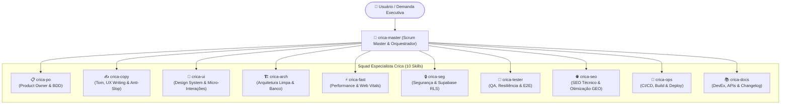

# 🚀 CRICA TEAM — Squad de IA Especializada & Orquestração Autônoma

> **CRICA-Team** é uma suíte multidisciplinar com **11 Skills de Engenharia, Produto e Qualidade** para agentes de IA (Google Antigravity), operando sob governança de Scrum Master com protocolos rígidos de handoff e Definition of Done (DoD).

---

## 🏛️ Estrutura da Squad



---

## 🧩 As 11 Skills Especializadas

| Skill | Nome / Atuação | Foco Principal & Entregáveis |
| :--- | :--- | :--- |
| [`crica-master`](crica-master/SKILL.md) | **Scrum Master & Orquestrador** | Orquestração da squad, sprints, grafo de execução, handoffs e 10 portões de DoD. |
| [`crica-po`](crica-po/SKILL.md) | **Product Owner** | User stories, critérios de aceite BDD/Gherkin, escopo mínimo e regras de negócio. |
| [`crica-copy`](crica-copy/SKILL.md) | **UX Writer & Copywriter** | Proposta de valor, clareza sem jargões genéricos de IA, microcopys e mensagens de erro. |
| [`crica-ui`](crica-ui/SKILL.md) | **UI/UX Designer & Frontend** | Design system semântico, micro-interações, acessibilidade WCAG e fluidez visual. |
| [`crica-arch`](crica-arch/SKILL.md) | **Software Architect** | Modelagem relacional, isolamento de camadas, contratos Zod e tipagem estrita. |
| [`crica-fast`](crica-fast/SKILL.md) | **Performance Engineer** | Otimização de queries, eliminação de N+1, divisão de bundles e Core Web Vitals. |
| [`crica-seg`](crica-seg/SKILL.md) | **Security Engineer** | Blindagem OWASP, políticas Supabase RLS, sanitização e prevenção de vazamentos. |
| [`crica-tester`](crica-tester/SKILL.md) | **QA & Test Engineer** | Varredura de fluxos quebrados, automação E2E (Playwright) e testes de regressão. |
| [`crica-seo`](crica-seo/SKILL.md) | **SEO & GEO Specialist** | Metadados dinâmicos, dados estruturados JSON-LD, sitemaps e GEO (`llms.txt`). |
| [`crica-ops`](crica-ops/SKILL.md) | **DevOps & Release Engineer** | Pipelines CI/CD (GitHub Actions), validação de build/lint, deploy e estratégias de rollback. |
| [`crica-docs`](crica-docs/SKILL.md) | **Technical Writer** | Documentação de APIs (OpenAPI), manuais de arquitetura, READMEs e changelogs. |

---

## 🎯 4 Playbooks Padrão de Missão

1. **Full-Cycle Feature**: Ciclo completo da concepção ao deploy (`PO` ➔ `COPY` ➔ `ARCH` ➔ `UI` ➔ `FAST/SEG` ➔ `TESTER` ➔ `SEO` ➔ `OPS` ➔ `DOCS`).
2. **Pre-Launch Hardening**: Auditoria 360° pré-lançamento focada em robustez, blindagem e desempenho.
3. **Crisis Remediation**: Resolução cirúrgica de incidentes e contenção de falhas com garantia de não-regressão.
4. **Growth & Discoverability**: Otimização de conversão, autoridade de marca, SEO técnico e prontidão para IA gerativa (GEO).

---

## 📦 Como Usar

Clone o repositório dentro do seu diretório de skills configurado no Antigravity:

```bash
git clone https://github.com/rafaeljaragua/Crica-Team.git
```

Ou aponte o diretório global de skills (`.gemini/config/skills` ou `.agents/skills`) para este pacote.

---

## 📄 Licença

Distribuído sob a licença [MIT](LICENSE).
