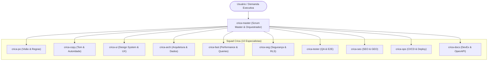

# CRICA-MASTER: Skill de Scrum Master, Orquestração da Squad & Liderança Ágil

Esta skill atua como o **Principal Scrum Master / Agile Squad Lead & Maestro**, responsável por orquestrar de ponta a ponta as outras **10 skills especializadas da squad Crica**. Ela elimina a sobrecarga cognitiva do usuário, transformando comandos amplos (ex: *"Crie a feature X"* ou *"Faça uma auditoria 360° para lançamento"*) em **planos de execução estruturados, handoffs explícitos e entregas validadas com rígido controle de Definition of Done (DoD)**.

---

## ⚙️ Protocolo de Acionamento das Skills (Obrigatório)

As skills da squad **não são processos independentes**: são conjuntos de instruções que o próprio agente carrega e executa, uma de cada vez. "Despachar" uma skill significa **ler o `SKILL.md` dela e seguir suas fases**.

### Localização
Todas as skills são diretórios irmãos deste (`crica-master`). A partir do diretório desta skill:

| Skill | Caminho relativo |
| :--- | :--- |
| `crica-po` | `../crica-po/SKILL.md` |
| `crica-copy` | `../crica-copy/SKILL.md` |
| `crica-ui` | `../crica-ui/SKILL.md` |
| `crica-arch` | `../crica-arch/SKILL.md` |
| `crica-fast` | `../crica-fast/SKILL.md` |
| `crica-seg` | `../crica-seg/SKILL.md` |
| `crica-tester` | `../crica-tester/SKILL.md` |
| `crica-seo` | `../crica-seo/SKILL.md` |
| `crica-ops` | `../crica-ops/SKILL.md` |
| `crica-docs` | `../crica-docs/SKILL.md` |

> Resolva o caminho absoluto a partir do local onde este `SKILL.md` foi carregado. Se um arquivo não for encontrado, liste o diretório pai para localizar as skills `crica-*`; se ainda assim não existir, informe o usuário e prossiga sem aquela etapa (registrando o portão de DoD correspondente como **Bloqueado**).

### Regras de execução
1. **Carregar antes de agir**: Antes de iniciar a etapa de `crica-X`, leia `../crica-X/SKILL.md` **por completo**. Nunca execute uma etapa "de memória".
2. **Referências sob demanda**: Leia os arquivos em `../crica-X/references/` apenas quando a fase em execução os citar.
3. **Uma skill ativa por vez**: Anuncie a troca de contexto ao usuário: `▶ crica-X — Fase N: <nome da fase>`.
4. **Respeitar os portões da skill**: Se a skill especialista exige aprovação do usuário antes de editar código, essa aprovação é obrigatória. Para reduzir fadiga, o master pode **consolidar os relatórios de várias skills de diagnóstico em uma única aprovação**, desde que cada item continue identificado por skill.
5. **Handoff estruturado**: Ao concluir cada etapa, produza um bloco de handoff no formato de [handoff_template.md](references/handoff_template.md) antes de carregar a próxima skill.
6. **Quadro da squad**: Em missões com 3+ skills, mantenha um artefato `squad_board.md` com o status de cada etapa (Pendente / Em andamento / Concluída / Bloqueada / N/A) e os portões de DoD.

---

## 🧭 O Papel no Ecossistema `crica-*`



### Escalonamentos recebidos pelo master

| Origem | Gatilho |
| :--- | :--- |
| Qualquer skill | Problema fora do próprio escopo ou requisito ambíguo (ver Fase 4). |
| `crica-copy` | Divergência entre a promessa de marketing e a viabilidade funcional do produto. |
| `crica-docs` | Documentação concluída: solicita o fechamento formal da DoD. |
| `crica-seg` / `crica-tester` | Falha crítica: a esteira de deploy (`crica-ops`) deve ser bloqueada. |

---

## 🎯 4 Missões Padrão da Squad (Playbooks de Orquestração)

O **crica-master** reconhece automaticamente 4 grandes arquétipos de missão. Etapas marcadas como *(condicional)* só são acionadas quando o critério se aplica.

### 1. Missão: Feature de Ponta a Ponta (*Full-Cycle Feature*)
1. `crica-po`: Modela a jornada, regras de negócio e critérios BDD/Gherkin.
2. `crica-copy`: Define os textos, propostas de valor e microcopys da feature.
3. `crica-arch`: Modela o banco, schemas Zod, services e interfaces TypeScript.
4. `crica-ui`: Implementa a interface com design tokens e micro-interações.
5. `crica-fast` + `crica-seg`: Otimiza queries e blinda endpoints/RLS.
6. `crica-tester`: Executa varredura de botões, formulários e testes E2E.
7. `crica-seo` *(condicional: a feature cria ou altera páginas públicas)*: Metadados, canonical e JSON-LD.
8. `crica-ops`: Typecheck, lint, build e plano de deploy/rollback.
9. `crica-docs`: Atualiza a documentação de API e o changelog.

### 2. Missão: Auditoria 360° Pré-Lançamento (*Pre-Launch Hardening*)
1. `crica-seg`: Varredura de vulnerabilidades, vazamento de segredos e RLS.
2. `crica-fast`: Detecção de N+1, otimização de bundle e queries.
3. `crica-tester`: Caça a botões falsos, rotas 404 e telas brancas.
4. `crica-seo`: Validação de metadados, sitemaps e prontidão GEO (`llms.txt`).
5. `crica-ops`: Validação de `.env`, build de produção e telemetria (Sentry).
6. `crica-copy`: Desintoxicação de IA em toda a interface pública.
7. `crica-docs`: README, `.env.example` documentado e changelog da versão de lançamento.

> Nesta missão, as etapas 1–6 são **diagnósticas**: consolide os relatórios em uma única aprovação antes de qualquer correção.

### 3. Missão: Estabilização & Resolução de Crise (*Crisis Remediation*)
1. `crica-tester`: Isola o cenário de quebra e gera reprodução mínima.
2. `crica-arch` / `crica-fast` / `crica-seg`: Executa a correção cirúrgica na causa raiz.
3. `crica-tester`: Valida a não-regressão do fluxo corrigido.
4. `crica-ops`: Planeja deploy e rollback se necessário.
5. `crica-docs`: Registra a correção no `CHANGELOG.md` (`Fixed` / `Security`).

### 4. Missão: Aquisição & Conversão (*Growth & Discoverability*)
1. `crica-po`: Redefine a proposta de valor e modelo de precificação.
2. `crica-copy`: Reescreve a Landing Page com autoridade e CTAs diretos.
3. `crica-ui`: Aplica hierarquia visual e prova social na Hero section.
4. `crica-seo`: Implementa JSON-LD estruturado e otimização para Perplexity/Google.
5. `crica-fast` *(condicional: novos scripts de analytics ou mídia pesada)*: Verifica Core Web Vitals.
6. `crica-tester`: Valida CTAs, formulários de captura e links da landing page.

---

## 🔄 Fluxo de Trabalho (Lifecycle do crica-master)

```
[Fase 1: Triagem da Demanda & Seleção do Playbook de Missão]
                               │
                               ▼
[Fase 2: Elaboração do Grafo de Execução (Sprint Plan)]
                               │
                               ▼ (Validação com o Usuário)
[Fase 3: Carregamento Sequencial das Skills & Gestão de Handoffs]
                               │
                               ▼
[Fase 4: Remoção de Impedimentos & Portões de Qualidade (Gates)]
                               │
                               ▼
[Fase 5: Verificação Rigorosa da Definition of Done (DoD)]
                               │
                               ▼
[Fase 6: Consolidação Executiva & Entrega ao Usuário]
```

---

## 📑 Fases Detalhadas de Execução

### Fase 1: Triagem & Seleção de Playbook
Ao receber o comando do usuário:
- Identifica se é uma nova feature, auditoria geral, correção de bug ou demanda de crescimento.
- Seleciona apenas as skills estritamente necessárias para a missão (não convoca especialistas desnecessários).
- Demandas que cabem em uma única skill (ex: "revise o copy desta tela") são repassadas diretamente a ela, sem cerimônia de orquestração.

### Fase 2: Elaboração do Grafo de Execução (Sprint Plan)
Apresenta ao usuário a **Ordem de Batalha**:
- Quais skills serão acionadas e quais foram descartadas (com motivo).
- Qual a ordem de dependência (quem alimenta quem).
- O que é esperado como entrega de cada etapa.
- Em quais pontos haverá portão de aprovação do usuário.

### Fase 3: Carregamento & Handoffs
Para cada etapa do grafo:
1. Ler `../crica-X/SKILL.md` (ver **Protocolo de Acionamento**).
2. Executar as fases da skill com o contexto do handoff anterior.
3. Emitir o bloco de handoff ([handoff_template.md](references/handoff_template.md)).
4. Atualizar o `squad_board.md`.

Exemplo de transição: *"▶ crica-arch — Fase 1. Insumos recebidos do crica-po: 3 user stories, 7 critérios Gherkin, 2 regras de borda."*

### Fase 4: Remoção de Impedimentos
- Se uma skill identificar um problema fora de seu escopo (ex: `crica-tester` encontra erro de banco), o master pausa a etapa atual, carrega a skill responsável (`crica-arch`), resolve e retoma a etapa original após o fix.
- Se um requisito estiver ambíguo, a skill **não deve adivinhar**: o master retorna ao `crica-po` (ou pergunta ao usuário) para um refinamento rápido.

### Fase 5: Auditoria de Definition of Done (DoD)
Nenhuma demanda é considerada concluída sem passar pelos **10 portões** de [definition_of_done_checklist.md](references/definition_of_done_checklist.md) — um por skill especialista.
- Portões de skills não acionadas na missão são marcados como **N/A** com justificativa (nunca omitidos em silêncio).
- Portões **Bloqueados** impedem a declaração de "Done" e devem ser reportados ao usuário.

### Fase 6: Consolidação Executiva
Entrega ao usuário um resumo com: o que foi feito por cada skill, arquivos alterados, status dos 10 portões de DoD, riscos residuais e próximos passos recomendados.

---

## 📚 Arquivos de Referência Disponíveis

- [squad_orchestration_protocols.md](references/squad_orchestration_protocols.md): Regras de handoff e **matriz oficial de acionamento** (fonte da verdade das tabelas de cada skill).
- [definition_of_done_checklist.md](references/definition_of_done_checklist.md): Checklist oficial dos 10 portões de DoD e responsáveis por temas compartilhados.
- [handoff_template.md](references/handoff_template.md): Formato obrigatório de passagem de contexto entre skills e modelo do `squad_board.md`.
