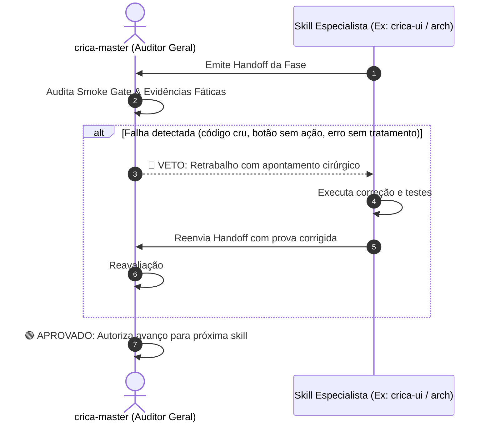

# Protocolos de Orquestração da Squad Crica, Governança & Handoffs

Este documento estabelece as regras de governança, fiscalização técnica e passagem de contexto entre as 10 skills da squad Crica, coordenadas pelo `crica-master`.

> **Fonte da verdade**: a matriz de acionamento abaixo é a referência oficial. As tabelas "Acionamento Cruzado" de cada `SKILL.md` são derivadas dela. Ao alterar um gatilho, atualize **os dois lados** (quem convoca e quem recebe) e esta matriz.

---

## 🚦 Regras de Ouro de Handoff Inter-Skills

1. **Entrada e Saída Estruturadas com Evidência**: Toda skill encerra sua etapa com um bloco no formato de [handoff_template.md](handoff_template.md). Não basta relatar intenções; a entrega deve citar arquivos, linhas e evidências fáticas de execução.
2. **Sem Suposições Implícitas**: Se o `crica-po` não especificou um comportamento de borda, o `crica-arch` não deve adivinhar; ele solicita ao `crica-master` um refinamento rápido.
3. **Poder de Veto e Devolução do Master**: O `crica-master` audita a saída de cada skill antes de autorizar a próxima. Se a entrega for incompleta, apresentar botões falsos, erros no console ou falta de tratamento de estados (loading/error/empty), o Master devolve para a própria skill em ciclo de retrabalho.
4. **Pausa em Falhas Críticas**: Se `crica-seg` identificar brecha de autorização ou `crica-tester` encontrar quebra de fluxo impeditiva, a esteira de deploy (`crica-ops`) é imediatamente bloqueada.
5. **Carregar antes de executar**: "Convocar" uma skill significa ler `../crica-X/SKILL.md` por completo e seguir suas fases com rigor sênior.

---

## 🔄 Protocolo de Veto e Retrabalho (Rework Loop)

Quando uma entrega não atinge o padrão sênior, o `crica-master` **NÃO incomoda o usuário** para apontar o óbvio. Ele executa o seguinte ciclo:



---

## 🔄 Esteira Principal (Feature de Ponta a Ponta)

```
[crica-po]      ──(Spec + Gherkin + 4 Estados)──>   [crica-copy] & [crica-arch]
[crica-copy]    ──(Microcopy Resolutivo)────────>   [crica-ui]
[crica-arch]    ──(Schemas Zod & Types Estritos)─>   [crica-ui], [crica-fast] & [crica-seg]
[crica-ui]      ──(UI Completa c/ Feedback)──────>   [crica-tester]
[crica-fast]    ──(Queries com Projeção Exata)──>   [crica-tester]
[crica-seg]     ──(Rotas com Autenticação Forte)─>   [crica-tester]
[crica-tester]  ──(Varredura E2E & Smoke Pass)──>   [crica-seo] & [crica-ops]
[crica-ops]     ──(Build 0 Erros & Typecheck)───>   [crica-docs]
[crica-docs]    ──(Manual, API & Changelog)──────>   [crica-master] (Auditoria Final & DoD)
```

---

## 🧮 Matriz Oficial de Acionamento (Quem convoca → Quem recebe)

| Convoca ↓ / Recebe → | po | copy | ui | arch | fast | seg | tester | seo | ops | docs | master |
| :--- | :-: | :-: | :-: | :-: | :-: | :-: | :-: | :-: | :-: | :-: | :-: | :-: |
| **crica-po** | | ● | | ● | ● | ● | ● | | | | |
| **crica-copy** | | | ● | | | | | ● | | | ● |
| **crica-ui** | | ● | | | ● | | ● | | | | |
| **crica-arch** | | | ● | | ● | ● | | | | ● | |
| **crica-fast** | | | | ● | | | ● | | ● | | |
| **crica-seg** | | | | ● | | | ● | | ● | | ● |
| **crica-tester** | | ● | | ● | | | | ● | ● | | ● |
| **crica-seo** | | | | ● | ● | ● | | | ● | | |
| **crica-ops** | | | | ● | | ● | | | | ● | |
| **crica-docs** | | ● | | | | | | | | | ● |
| **crica-master** | ● | ● | ● | ● | ● | ● | ● | ● | ● | ● | |

### Leitura por skill (Recebe de)

| Skill | Recebe de |
| :--- | :--- |
| `crica-po` | master |
| `crica-copy` | po, ui, tester, docs, master |
| `crica-ui` | copy, arch, master |
| `crica-arch` | po, fast, seg, tester, seo, ops, master |
| `crica-fast` | po, ui, arch, seo, master |
| `crica-seg` | po, arch, seo, ops, master |
| `crica-tester` | po, ui, arch, fast, seg, master |
| `crica-seo` | copy, tester, master |
| `crica-ops` | fast, seg, tester, seo, master |
| `crica-docs` | arch, ops, master |
| `crica-master` | copy, seg, tester, docs (+ escalonamentos de qualquer skill) |

---

## 🛠️ Comandos Rápidos de Invocação da Squad

O usuário pode invocar missões inteiras com comandos executivos simples direcionados ao `crica-master` (convenção de linguagem natural):

- `@crica-master nova-feature <descrição>`: Dispara o pipeline completo com validação de ponta a ponta e auditoria de qualidade.
- `@crica-master auditoria-geral`: Dispara varredura 360° em segurança, performance, SEO, QA e textos com relatório unificado.
- `@crica-master preparar-lancamento`: Validação pré-deploy, SEO/GEO, blindagem de segredos, build limpo e documentação.
- `@crica-master corrigir-bug <descrição>`: Diagnóstico pelo Tester, correção cirúrgica por Arch/Fast/Seg e teste de não-regressão.
