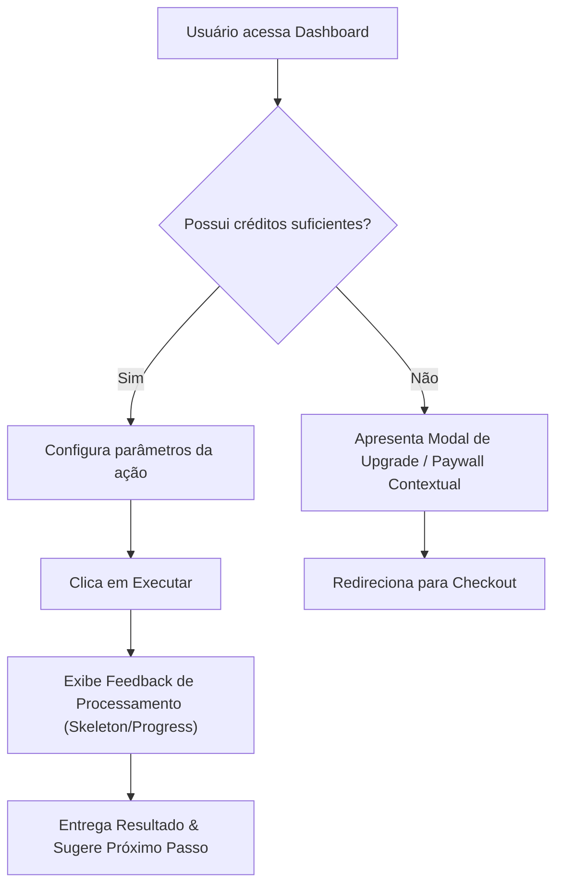

# 📐 Template de Especificação Executiva de Funcionalidade (User Story & BDD)

Utilize este modelo padronizado para transformar decisões de produto em especificações claras, precisas e prontas para execução pela engenharia.

---

# 🚀 [Nome da Feature / Módulo]

## 1. 🎯 Visão Geral & Objetivo de Negócio
- **Problema / Oportunidade**: Descrição clara da dor do usuário que estamos resolvendo ou da métrica que pretendemos impactar.
- **Público Impactado**: [Persona / Tipo de Plano / Usuário Gratuito vs Pago]
- **Métrica de Sucesso (KPI)**: [Ex: Aumentar conversão no checkout em 15%, Reduzir tempo de setup para < 1 min]

---

## 2. 👤 Histórias de Usuário (User Stories)

### História 1: [Título da Ação Principal]
> **Como** [tipo de usuário/persona],  
> **Quero** [realizar uma ação específica],  
> **Para que** [obter um benefício ou resultado mensurável].

---

## 3. ✅ Critérios de Aceite (BDD / Gherkin)

```gherkin
Cenário 1: [Fluxo Principal de Sucesso - Happy Path]
  Dado que o usuário está logado com um plano gratuito
  E possui saldo de 2 créditos restantes
  Quando ele clica no botão "Gerar Relatório Inteligente"
  Então o sistema processa o relatório em segundo plano
  E desconta 1 crédito do saldo exibido
  E apresenta a tela do relatório gerado com botão de exportar PDF

Cenário 2: [Limite de Créditos / Gatilho de Paywall]
  Dado que o usuário possui 0 créditos restantes
  Quando ele tenta clicar em "Gerar Relatório Inteligente"
  Então o sistema abre o modal de upgrade destacando os benefícios do plano Pro
  E exibe o botão com chamada direta para checkout em 1 clique

Cenário 3: [Tratamento de Falha / Timeout de API]
  Dado que o serviço de IA falhou ou excedeu o timeout de 15s
  Quando a geração falha
  Então o sistema exibe uma mensagem amigável: "Não foi possível gerar agora. Seus créditos não foram descontados."
  E oferece o botão "Tentar novamente"
```

---

## 4. 🧭 Fluxo da Jornada do Usuário (Diagrama Mermaid)



---

## 5. ⚙️ Regras de Negócio & Casos de Borda (Edge Cases)

| Regra / Condição | Comportamento Esperado do Sistema |
| :--- | :--- |
| **Empty State** | Exibir ilustração leve, texto explicativo e CTA: `+ Criar meu primeiro item`. |
| **Acesso Não Autorizado** | Redirecionar para login preservando a rota desejada via query param `?redirect=/rota`. |
| **Limite Atingido** | Bloquear ação, manter dados digitados no formulário (sem resetar) e disparar modal de upgrade. |
| **Perda de Conexão** | Apresentar banner discreto: `Sem conexão à internet. Suas alterações serão sincronizadas ao reconectar.` |

---

## 6. 📊 Instrumentação de Analytics (Eventos a Rastrear)

Para validar a entrega do valor após o deploy, os seguintes eventos devem ser disparados:

- `feature_opened`: Usuário visualizou a tela/modal da funcionalidade.
- `action_started`: Usuário iniciou a configuração/submissão.
- `action_completed`: Ação concluída com sucesso (*Métrica de Ativação*).
- `paywall_viewed`: Usuário atingiu limite e visualizou a oferta de upgrade.
- `upgrade_clicked`: Usuário clicou no botão de compra.
