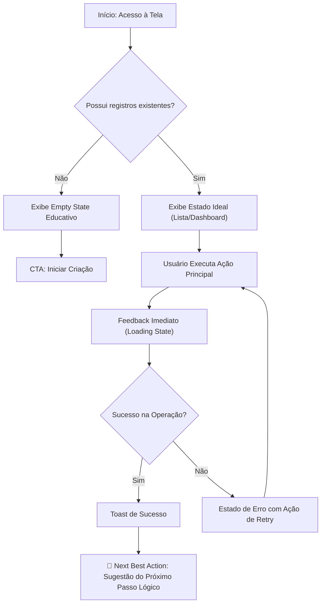

# 📐 Template de Especificação Executiva de Funcionalidade (User Story & BDD de Alto Rigor)

Utilize este modelo padronizado para transformar necessidades de produto em especificações executivas blindadas contra o amadorismo.
Toda especificação deve conter a **Matriz Obrigatória dos 4 Estados**, cenários BDD abrangentes (feliz + exceções) e a **Next Best Action** para erradicar becos sem saída (*dead ends*).

---

# 🚀 [Nome da Feature / Módulo]

## 1. 🎯 Visão Geral & Objetivo de Negócio
- **Problema / Dor Aguda**: Descrição precisa da dor do usuário que estamos resolvendo ou da métrica que pretendemos impactar.
- **Público Impactado**: [Persona / Tipo de Plano / Gratuito vs Pago]
- **Métrica de Sucesso (KPI)**: [Ex: Reduzir tempo de setup para < 1 min, Aumentar conversão no checkout em 15%]

---

## 2. 👤 Histórias de Usuário (User Stories)

### História 1: [Título da Ação Principal]
> **Como** [tipo de usuário/persona],  
> **Quero** [realizar uma ação específica],  
> **Para que** [obter um benefício ou resultado mensurável].

---

## 3. 🖼️ Matriz Obrigatória dos 4 Estados (Regra de Ouro)

Toda funcionalidade que apresente dados, listas, formulários ou modais **DEVE** ter seus 4 estados formalmente detalhados:

| Estado | Descrição Visual e Comportamental | Componente de UI / Mensagem | Ação do Usuário |
| :--- | :--- | :--- | :--- |
| **1. Ideal (Happy Path)** | Dados carregados completamente com sucesso. Layout fluido, interações ativas e hierarquia limpa. | Cards/Tabelas com dados formatados e CTAs secundários contextuais. | Navegar, editar, exportar ou filtrar. |
| **2. Carregando (Loading)** | Operação assíncrona ou carregamento inicial. Botões de ação desabilitados para evitar clique duplo. | Skeletons contextuais (que espelham o layout final) ou spinner com mensagem de progresso. | Aguardar; ações bloqueadas preventivamente. |
| **3. Vazio (Empty State)** | Nenhum registro existente para o usuário ou busca sem resultados. Proibida tela deserta. | Ilustração/ícone sutil + texto explicativo de por que está vazio + CTA destacado. | CTA principal: `+ Criar meu primeiro [item]` ou `Limpar filtros de busca`. |
| **4. Erro (Error State)** | Falha de rede, timeout, validação rejeitada ou erro 500 do backend. Proibidos códigos crus. | Banner ou card de alerta: texto explicando o motivo amigavelmente + instruções de resolução. | CTA resolutivo: `Tentar novamente` ou `Editar dados e reenviar`. |

---

## 4. ✅ Critérios de Aceite (BDD / Gherkin)

```gherkin
Cenário 1: [Fluxo Principal de Sucesso - Happy Path]
  Dado que o usuário está logado com perfil ativo
  E preencheu todos os campos obrigatórios corretamente
  Quando ele clica no botão de submissão
  Então o botão entra em estado de carregamento e fica desabilitado
  E os dados são persistidos no backend com sucesso
  E uma notificação toast de confirmação é exibida
  E o sistema direciona o usuário para a Próxima Melhor Ação (Next Best Action)

Cenário 2: [Validação de Entrada & Casos Limítrofes]
  Dado que o usuário informou um campo com formato inválido ou texto excedendo o limite
  Quando o campo perde o foco ou na tentativa de submissão
  Então o sistema exibe feedback de validação inline abaixo do campo específico
  E o botão de envio permanece desabilitado ou impede o disparo
  E os dados previamente digitados não são apagados

Cenário 3: [Falha de Rede / Timeout / Erro de Servidor]
  Dado que a chamada assíncrona falhou ou excedeu o tempo limite de 10s
  Quando a resposta de erro é recebida
  Então o sistema restaura o botão para o estado interativo
  E exibe mensagem clara: "Não foi possível concluir a ação. Verifique sua conexão e tente novamente."
  E oferece o botão de "Tentar novamente" sem recarregar a página inteira

Cenário 4: [Empty State e Primeiro Uso]
  Dado que o usuário não possui nenhum item cadastrado
  Quando ele acessa a tela pela primeira vez
  Então o sistema não exibe tabela vazia crua
  E apresenta o componente de Empty State com orientação de boas-vindas
  E destaca o botão "+ Criar primeiro registro"
```

---

## 5. 🧭 Fluxo da Jornada & Erradicação de Becos sem Saída (Next Best Action)



> **Regra Anti-Dead End**: Ao concluir qualquer fluxo de sucesso, defina qual é a **Next Best Action** (ex: *"Após criar a campanha, redirecionar automaticamente para a tela de disparo com banner de sugestão de teste"*).

---

## 6. ⚙️ Casos de Borda, Limites & Salvaguardas Regulatórias (Edge Cases)

| Cenário de Borda | Risco Técnico / UX | Solução de Produto Obrigatória |
| :--- | :--- | :--- |
| **Payload/Texto Excessivo** | Quebra de layout ou overflow | Truncar com reticências no card e tooltip expansível; validação com limite no schema. |
| **Cliques Repetidos Rápidos** | Criação de duplicatas no banco | Debounce no clique + estado `isSubmitting=true` desabilitando o botão no primeiro toque. |
| **Perda Súbita de Internet** | Dados preenchidos perdidos | Salvar rascunho temporário em `localStorage` ou exibir banner de reconexão sem resetar o form. |
| **Permissão Insuficiente** | Usuário sem acesso à rota | Redirecionamento amigável com explicação: "Esta função exige perfil de Administrador". |
| **Cancelamento em 7 Dias (CDC 49)** | Risco jurídico Procon/JEC | Se envolver checkout/billing, botão ou fluxo de cancelamento/estorno em até 7 dias sem burocracia. |
| **Exclusão de Conta (Apple/LGPD)** | Risco de banimento em App Stores | Área de configurações com botão explícito de "Excluir Conta e Dados" que apaga registros do banco. |
| **Recurso Baseado em IA (EU AI Act)** | Risco regulatório europeu | Identificação explícita de conteúdo gerado por IA + aviso de que dados privados não são usados em treinamento. |

---

## 7. 📊 Instrumentação de Métricas (Analytics)

- `feature_viewed`: Exibição da funcionalidade ou tela.
- `action_submitted`: Tentativa de submissão do formulário.
- `action_succeeded`: Sucesso na persistência (Métrica de Ativação).
- `action_failed`: Erro retornado (com propriedade `error_code` para monitoramento).
- `next_best_action_clicked`: Engajamento com a ação recomendada seguinte.

---

## 📋 Protocolo de Product Acceptance Sign-off (Auditoria Final do PO)

Antes do fechamento da sprint, o PO executa este checklist sobre a entrega real:
- [ ] **Todos os cenários BDD/Gherkin foram implementados e validados?**
- [ ] **Os 4 Estados (Ideal, Loading, Empty, Error) estão esteticamente polidos e funcionais?**
- [ ] **Existe tratamento de clique duplo e estados de desabilitado?**
- [ ] **O fluxo termina com a Next Best Action (sem dead ends)?**
- [ ] **Acessibilidade básica validada (alvos clicáveis por teclado e contraste WCAG)?**
- [ ] **Salvaguardas regulatórias cumpridas (reembolso legal, exclusão de conta e transparência de IA)?**
- [ ] **A experiência transmite acabamento profissional e autoridade?**

*Parecer*: `[ ] 🟢 SIGN-OFF APROVADO` | `[ ] 🔴 REJEITADO (Devolver para Retrabalho com Apontamentos)`

