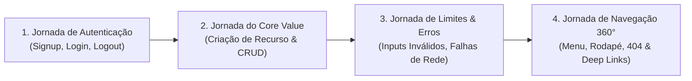

# Playbook de Testes Ponta a Ponta (E2E) & Navegador

Este guia estabelece o roteiro padronizado para executar testes dinâmicos de ponta a ponta (E2E), simulando ações reais de usuários na interface via navegador ou ferramentas automatizadas (Playwright, Puppeteer ou subagentes de browser).

---

## 🧭 As 4 Jornadas Críticas de Teste

Toda aplicação web ou SaaS deve ser submetida aos testes destas 4 jornadas antes de ser considerada estável:

---

## 🔑 1. Roteiro: Jornada de Autenticação

1. **Acessar `/signup` ou modal de cadastro**:
   - Tentar submeter sem preencher campos ➔ Esperado: Bloqueio client-side com mensagens de erro nos campos.
   - Preencher com credenciais válidas e submeter ➔ Esperado: Botão entra em estado de carregamento, o usuário é redirecionado para o dashboard (`/app` ou `/dashboard`) e recebe cookie/token de sessão.
2. **Persistência de Sessão**:
   - Dar refresh na página (`F5`) ➔ Esperado: Usuário permanece logado, sem piscar de tela branca ou redirecionamento involuntário para `/login`.
3. **Logout**:
   - Clicar em "Sair / Logout" ➔ Esperado: Sessão destruída, redirecionamento imediato para a página pública ou de login.
   - Tentar acessar `/dashboard` diretamente via barra de endereços ➔ Esperado: Redirecionamento forçado para `/login`.

---

## ⚡ 2. Roteiro: Jornada do Core Value (CRUD)

1. **Estado Inicial Vazio**:
   - Acessar a tela principal do recurso (ex: listagem de projetos, faturas, produtos).
   - Validar se o *Empty State* é exibido com um botão claro de criação.
2. **Criação de Registro**:
   - Clicar no botão "Novo / Criar".
   - Preencher o formulário e salvar.
   - Validar se o registro aparece na listagem imediatamente, sem necessidade de recarregar a página manualmente.
3. **Edição e Atualização**:
   - Abrir o registro recém-criado, alterar um campo de texto e salvar.
   - Validar se o valor atualizado reflete na tabela ou no card.
4. **Exclusão com Confirmação**:
   - Clicar no botão de exclusão.
   - Validar se um modal de confirmação é exibido (sem deleção imediata por acidente).
   - Confirmar a exclusão e verificar se o item desaparece da lista.

---

## 💣 3. Roteiro: Teste de Estresse & Casos de Borda

1. **Carga com Texto Longo**:
   - Inserir um texto de 500 caracteres em campos de título ou nome.
   - Validar se a interface não quebra o layout (texto estourando container horizontal ou verticalmente).
2. **Caracteres Especiais**:
   - Inserir tags HTML, emojis, aspas e barras (`<script>`, `'`, `"`, `/`, `\`).
   - Validar se os dados são devidamente sanitizados e renderizados como texto puro, sem erros de XSS ou quebra de JSON.
3. **Duplo Clique Rápido (Double Click Stress)**:
   - Clicar duas vezes rapidamente no botão de submissão.
   - Validar se a aplicação não cria dois registros duplicados no banco de dados.

---

## 🗺️ 4. Roteiro: Varredura de Navegação 360°

1. **Menu de Navegação Principal**:
   - Clicar sequencialmente em cada link da barra superior ou barra lateral.
   - Verificar se todas as rotas respondem sem erro de 404 e sem exceptions no console do navegador (`F12 Console`).
2. **Rodapé e Links Externos**:
   - Inspecionar todos os links de termos, privacidade, documentação e redes sociais.
   - Validar se links externos abrem com `target="_blank"` e `rel="noopener noreferrer"`.
3. **Página de Rota Não Existente**:
   - Digitar propositalmente uma URL inexistente (ex: `/rota-que-nao-existe-teste-404`).
   - Validar se a página 404 personalizada é exibida com um botão funcional de "Voltar ao Início".
